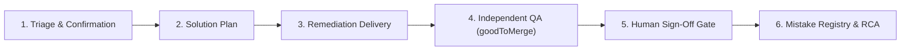
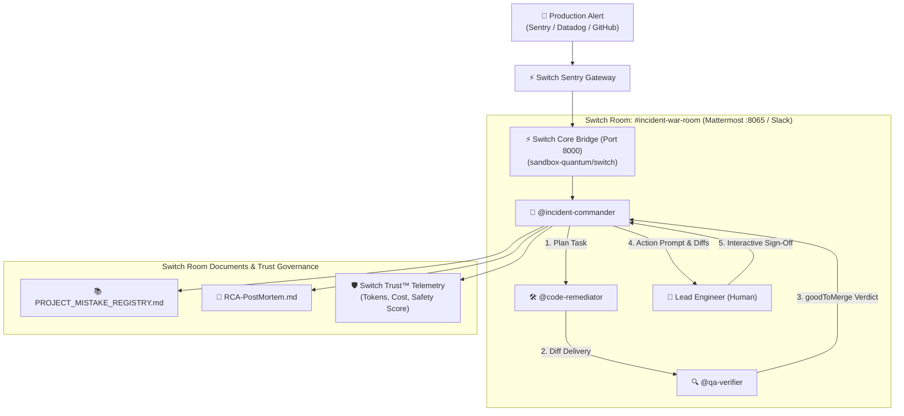

# Switch Sentry
> **Autonomous Multi-Agent Incident Response & Quality Governance Squad**  
> *Built for the WeMakeDevs x DevTools Academy "Flip the Switch" Hackathon • Track: Best Business Workflow*  
> *Powered by [SandboxAQ Switch](https://github.com/sandbox-quantum/switch) & the Switch Trust Framework*  
> *Workflow Architecture inspired by the Ziki Autonomous SDLC*

---

##  Overview

Today, AI coding assistants (Claude Code, Cursor, OpenCode) live isolated inside individual developer terminals. When a critical production incident strikes ($P0$ outage, payment gateway crash, database deadlock), engineers scramble across fragmented tools: Slack threads, monitoring dashboards, and local terminal sessions.

**Switch Sentry** transforms siloed terminal agents into a disciplined, collaborative **Multi-Agent Incident Squad** inside your team chat channels (Mattermost, Slack, Discord).

###  Core Ideas
Instead of a single agent acting as a black box, Switch Sentry enforces a rigorous **6-stage quality lifecycle**:



1. **`@incident-commander` (Coordination & Triage)**: Confirms alert, checks existing anti-patterns in the Mistake Registry, coordinates squad handoffs, and enforces human approvals.
2. **`@code-remediator` (Solver & Delivery)**: Formulates an explicit Solution Plan before touching code, then delivers a surgical, minimal unified diff patch.
3. **`@qa-verifier` (Independent Peer Reviewer)**: Following Ziki's rule that *an independent agent must test delivered work*, the QA verifier tests the patch with zero bias and issues a formal `goodToMerge: TRUE/FALSE` verdict.
4. **Human-in-the-Loop Sign-Off**: The lead engineer reviews the diff, test results, and QA verdict before clicking `[Approve Patch & Deploy]`.
5. **Living Project Mistake Registry**: Upon resolution, the root-cause anti-pattern is logged into the project's living Mistake Registry (stored as a Switch Room Document `PROJECT_MISTAKE_REGISTRY.md`) so subsequent agent runs never repeat the same bug.

---

##  Architecture



---

##  Switch Template Specification

Switch Sentry is defined as an official **Switch YAML Template** ([`templates/switch-sentry.template.yaml`](templates/switch-sentry.template.yaml)):

```yaml
version: 1
params:
  incident_channel:
    type: string
    default: incident-war-room
  bridge:
    type: bridge
    default: [$first]
agents:
  - name: "incident-commander"
    provider: claude
    instructions: |
      Triage production alerts, check Mistake Registry, assign planning,
      require independent QA verification, and enforce human sign-off.
  - name: "code-remediator"
    provider: codex
    instructions: |
      Consult Mistake Registry, formulate explicit solution plan,
      and craft minimal unified diff patch.
  - name: "qa-verifier"
    provider: opencode
    instructions: |
      Independently review patch diffs, execute regression test suite,
      and issue formal goodToMerge verdict.
room:
  name: "{incident_channel}"
  agents: ["incident-commander", "code-remediator", "qa-verifier"]
```

---

##  Quickstart

### 1. Prerequisites
* Python 3.10+
* Docker Desktop (for the local Switch + Mattermost stack)

### 2. Launch Local Switch Core Stack
```powershell
# Starts Switch Core (:8000), Mattermost (:8065), and Postgres (:55432)
powershell -ExecutionPolicy Bypass -File infra/switch-up.ps1
```

### 3. Launch the Switch Sentry War Room
```powershell
# Install requirements
pip install -r requirements.txt

# Start the War Room UI
python run.py
```
Open **[http://localhost:8080](http://localhost:8080)** in your browser!

You can also open Mattermost at **[http://localhost:8065](http://localhost:8065)** (login `user` / password from `infra/switch.env`) to see real messages mirrored to the `Town Square` channel in real time!

---

## Automated Test Suite

Run the full end-to-end test suite:

```powershell
python -m pytest tests/test_sentry.py -v
```

---


---

## Switch Trust™ Integration
* **Cost Governance:** Real-time token tracking with cost attribution.
* **Safety Scoring:** Evaluates regression risks and deduces confidence if dangerous actions are attempted without verification.
* **Audit Trail:** Every reasoning step and tool call is timestamped and recorded in the incident record.
