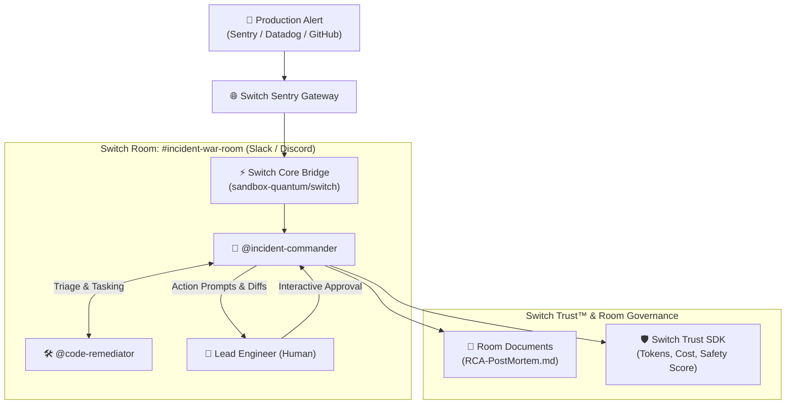

# ⚡ Switch Sentry
> **Autonomous Multi-Agent Incident Response & Code Remediation Squad for Engineering Teams**  
> *Built for the WeMakeDevs x DevTools Academy "Flip the Switch" Hackathon • Track: Best Business Workflow*  
> *Powered by [SandboxAQ Switch](https://github.com/sandbox-quantum/switch) & the Switch Trust Framework*

---

## 📌 Overview

Today, AI coding assistants (Claude Code, Cursor, OpenCode) live isolated inside individual developer terminals. When a critical production incident strikes ($P0$ outage, payment gateway crash, database deadlock), engineers scramble across fragmented tools: Slack threads, monitoring dashboards, and local terminal sessions.

**Switch Sentry** brings AI agents directly into the team's collaborative channel as first-class on-call responders:
1. **`@incident-commander`**: Ingests production alerts (Sentry / Datadog / GitHub), triages severity, orchestrates the war room, tracks telemetry, and publishes post-mortems.
2. **`@code-remediator`**: Pinpoints faulty source lines, synthesizes minimal reproduction unit tests, formulates clean unified git diffs, and verifies zero-regression safety.
3. **Human-in-the-Loop Safety**: No patch is deployed without interactive human sign-off via chat buttons (`[Approve & Deploy]`, `[Request Alternative]`, `[Reject]`).
4. **Switch Trust™ Telemetry**: Monitors token expenditure, latency, and model confidence scores in real time.

---

## 🏗️ Architecture



---

## 📂 Switch Template Specification

Switch Sentry is defined as an official **Switch YAML Template** (`templates/switch-sentry.template.yaml`), enabling instant one-click deployment into any Switch Console workspace:

```yaml
version: 1
params:
  incident_channel:
    type: string
    default: incident-war-room
  bridge:
    type: bridge
    default: [$first]
agents:
  - name: "incident-commander"
    addressing: anyone
    instructions: |
      Triage production alerts, assign reproduction to @code-remediator,
      enforce human approvals before deployment, and file post-mortems.
  - name: "code-remediator"
    addressing: owner-agents
    instructions: |
      Isolate root cause from stack trace, generate minimal regression tests,
      and formulate surgical unified diffs.
room:
  name: "{incident_channel}"
  agents: ["incident-commander", "code-remediator"]
```

---

## 🚀 Quickstart (Run in 30 Seconds)

### 1. Prerequisites
- Python 3.10+
- (Optional) Docker if connecting to live Switch Core instance

### 2. Setup & Installation
```bash
# Clone and enter the repository
cd switch-sentry

# Install dependencies
pip install -r requirements.txt
```

### 3. Launch the War Room
```bash
python run.py
```
Open **[http://localhost:8080](http://localhost:8080)** in your browser.

*Note: Switch Sentry features a dual-mode bridge. If a live Switch Core server (`http://localhost:8000`) is running, it connects automatically via HTTP/MCP. If running standalone, it activates an embedded in-memory room hub so judges and testers can run the full multi-agent simulation with zero Docker dependencies.*

---

## 🧪 Running Automated Tests

Run the full end-to-end test suite (triage, diff synthesis, human approval loop, and Trust Telemetry):

```bash
python -m pytest tests/test_sentry.py -v
```

---

## 🎬 2-Minute Demo Video Walkthrough Script (For Recording)

| Timestamp | Screen | Voiceover / Action |
| :--- | :--- | :--- |
| **0:00 – 0:25** | Slides / Intro | *"AI coding agents today are siloed on individual laptops. When production crashes at 2 AM, teams waste precious minutes jumping between Slack and terminal windows. Here is Switch Sentry."* |
| **0:25 – 0:50** | Web UI / Slack | Click **`+ Simulate Incident`** $\rightarrow$ select **`INC-P0-CHECKOUT`**. Show `@incident-commander` instantly announcing triage in `#incident-war-room` and tasking `@code-remediator`. |
| **0:50 – 1:20** | Tab 2: Code Diff | Switch to **Code Diff tab**. Show the generated unified diff fixing the payment gateway timeout, plus the verified unit test pass output. |
| **1:20 – 1:45** | Interactive Approval | Click **`[✅ Approve Patch & Deploy]`** directly in the chat. Show status transitioning to **RESOLVED** and the auto-generated **RCA Document** in Room Documents. |
| **1:45 – 2:00** | Sidebar / Trust HUD | Highlight **Switch Trust HUD** showing token budget, cost in \$USD, and audit logs. Conclude with how this turns solo agents into accountable team players. |

---

## 🛡️ Switch Trust™ Integration

Switch Sentry adheres to the `switch-trust-sdk` specification:
* **Cost Governance:** Accurately calculates prompt and completion costs against real token rates.
* **Safety Scoring:** Evaluates regression risks and deduces confidence if dangerous actions are attempted without approval.
* **Audit Trail:** Every reasoning step and tool call is timestamped and recorded in the incident record.

---

## 👥 Hackathon Submission Info
* **Team:** Flip the Switch Team
* **Event:** WeMakeDevs & DevTools Academy Hackathon
* **Powered by:** Switch AI (`sandbox-quantum/switch`)
